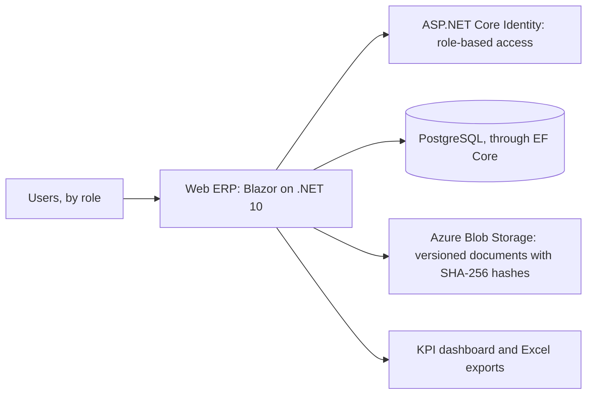

# Construction projects ERP: case study

> **Private code.** The source code belongs to the client and is not published. This repository is a case study: it describes the project at a high level, with no code, no screenshots and no internal details.

| | |
| --- | --- |
| **Client** | Ferrexpress |
| **Year** | 2026 |
| **Status** | Delivered |

## Context

Ferrexpress needed to manage all of its construction projects in one place: budgets, expenses, purchasing, progress and documentation.

## My role

Full-stack development of the system: the data model, the business rules of each module and the web interface.

## Architecture

- Projects move through a status workflow, with progress measured by stage.
- Budgets are versioned, and finances have approvals and budget alerts.
- Purchase orders accept partial receipts.
- Each project keeps a site log with photos and versioned documents.

## Key features

- Versioned budgets
- Budget alerts
- Purchase orders with partial receipts
- Site log with photos
- Versioned documents with SHA-256 hashes
- KPI dashboard and Excel export

## Stack

Blazor · .NET 10 · ASP.NET Core Identity · PostgreSQL · EF Core · Azure Blob Storage

## Results

Delivered in 2026: project, budget, purchasing and document control live in a single system, with a KPI dashboard and Excel exports.
